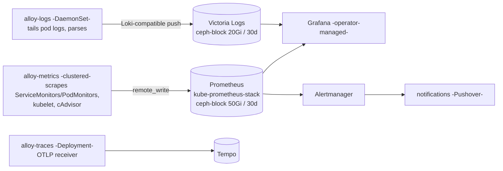

# Observability Architecture

A deep dive on the observability domain, split out of the
[reference architecture](reference-architecture.md) section 7 because the log-processing pipeline in
particular carries more design than fits a single reference-architecture section. It follows the same
shape: **how it works** (with diagrams), a **robust by design** note, and a **design decisions**
table. The fact IDs (R, X) are defined in the reference architecture's
[fact registers](reference-architecture.md#15-fact-registers).

**Facts:** R011 · X007

Related ADRs: [0008 — Victoria Logs over Loki](adr/0008-loki-to-victoria-logs.md) ·
[0013 — per-pod log-format parsing](adr/0013-structured-log-parsing-and-routing.md).

---

## 1. Shape of the stack

**Grafana Alloy** is the single collector, deployed as three purpose-built instances, each shipping
one signal to its store; **Grafana** (operator-managed) is the single query surface over all three.

- **Metrics:** `alloy-metrics` (clustered StatefulSet) scrapes all ServiceMonitors/PodMonitors plus
  each node's kubelet/cAdvisor, shards targets across replicas, and remote-writes to the
  **kube-prometheus-stack** Prometheus, which here is a _storage backend_ (its own scraping is
  disabled, selectors match a label nothing carries). Alertmanager routes to Pushover.
- **Logs:** `alloy-logs` (per-node DaemonSet) tails `/var/log/pods`, parses, and pushes to
  **Victoria Logs** over its Loki-compatible endpoint. The pipeline is section 3 below.
- **Traces:** `alloy-traces` (Deployment) receives OTLP and exports to **Tempo**.
- **Visualization:** Grafana is managed by the **grafana-operator** (the chart-bundled Grafana is
  disabled); dashboards and datasources are themselves CRs, with datasources for Prometheus, Victoria
  Logs (the `victoriametrics-logs-datasource` plugin), and Alertmanager. Reachable internally at
  `grafana.internal.${DOMAIN}`; Victoria Logs also has its own UI at `vlogs.internal.${DOMAIN}`.

All stateful backends (Prometheus, Grafana, Victoria Logs, Alertmanager) persist to `ceph-block`.

## 2. Backends

- **Prometheus (kube-prometheus-stack):** storage/query backend for metrics; accepts remote_write
  from `alloy-metrics` on `:9090`, 30-day / 40GiB retention on a 50Gi ceph-block PVC. The operator,
  Alertmanager, and Prometheus all log JSON (`logFormat: json`).
- **Victoria Logs:** single-binary `StatefulSet`, 30-day retention on a 20Gi ceph-block PVC, ingest
  on `:9428`. Chosen over Loki for footprint and a Loki-compatible ingestion path — see ADR 0008.
- **Tempo:** trace store; `alloy-traces` exports OTLP to it.

## 3. The log-processing pipeline

`alloy-logs` does more than ship bytes: it normalizes and parses so logs land in Victoria Logs as
structured, queryable records. The decisive fact is that **Victoria Logs auto-parses a JSON log line
on ingest** (flattening it into fields), so JSON is the zero-work path and everything else is routed
to a parser.

### 3.1 Universal pre-processing

Every line, regardless of source, passes through:

1. **`stage.cri`** — strip the containerd wrapper (`<time> <stream> <flags> <content>`), set the
   log timestamp from it, and lift `stream` (stdout/stderr) out.
2. **`stage.decolorize`** — strip ANSI color escapes, so colored logs neither pollute the message nor
   defeat a downstream parser's regex.
3. **`stream` → label; `cluster` → static label.**

### 3.2 `_msg` and the message field

Victoria Logs stores the headline text in `_msg`. For JSON logs it takes `_msg` from the first
present of the `_msg_field` list, set on the push URL to **`msg,message,fields.message,@mt`** (Go
`msg`, others' `message`, Rust `tracing`'s nested `fields.message`, Serilog `@mt`); for a non-JSON
line it falls back to the raw line. Without this, structured JSON logs would land with an empty `_msg`
(their message lives under `msg`/`message`/`fields.message`, not `_msg`). This is also why apps like
kopiur (Rust `tracing`, message at `fields.message`, `level` already top-level) need no parser — just
the `_msg_field` entry.

### 3.3 Stream fields (cardinality)

The push URL pins `_stream_fields=cluster,namespace,app,container,stream` — stable, low-cardinality
identifiers. High-churn values (`pod`, `node`) are still sent and searchable but deliberately kept
**out** of the stream identity so streams don't fragment. Parser-extracted fields (e.g. `level`) are
sent as **Loki structured metadata**, which Victoria Logs stores as ordinary non-stream fields — no
cardinality cost.

### 3.4 Per-pod format routing

Which parser runs is decided by a **pod annotation**, not by content sniffing or namespace — see
ADR 0013. A pod declares `logs.observability.home.arpa/format: <format>`; `alloy-logs` relabels that annotation
to an internal `log_format` label and `stage.match` routes on it, then drops the label before the
write. **JSON is the default: an unannotated pod is left to Victoria Logs' ingest parser.** Only
non-JSON pods are annotated.

| `log_format`      | What it parses                                       | Handling                                                                                  |
| ----------------- | ---------------------------------------------------- | ----------------------------------------------------------------------------------------- |
| _(none)_ / `json` | JSON lines                                           | default; Victoria Logs auto-parses on ingest                                              |
| `logfmt`          | `key=value` pairs                                    | `stage.logfmt` → `level` field, `_msg` from `msg`                                         |
| `klog`            | `I1124 … src.go:12] msg`                             | regex → `level` (native `I/W/E/F`), `_msg` = message                                      |
| `ceph`            | `debug <ts> <thr> <lvl> msg`                         | strip prefix → clean `_msg`; `level` from `[DBG/INF/WRN/ERR]`                             |
| `zap`             | `ts⇥LEVEL⇥logger⇥msg⇥{json}`                         | regex → `level`, `logger` fields, `_msg` = message                                        |
| `nginx`           | combined access log                                  | regex → `method`, `status` fields; `_msg` = raw line                                      |
| `cnpg`            | CloudNativePG JSON (Postgres wrapped under `record`) | JMESPath `record.message \|\| msg` → `_msg`; `record.error_severity \|\| level` → `level` |
| `plain`           | unstructured / proprietary                           | no parser; `_msg` = raw (decolorized) line                                                |

Each parser runs only inside its `stage.match`, so it never sees another format's lines and can
transform safely. `level` is kept in each format's **native vocabulary** (not normalized): the Alloy
chart renders its config through Helm's `tpl`, which would consume a `stage.template`'s `{{ … }}`, so
level-mapping templates are avoided. Formats beyond this set are annotated `plain` until a parser is
added.

### 3.5 Known limitations

- **Pod-level, not container-level.** A pod with mixed-format containers (e.g. the managed Envoy
  gateway pods: JSON from Envoy + zap from the shutdown-manager sidecar) carries one annotation; the
  minority container falls back to raw `_msg`. Such pods stay on the JSON default.
- **Operator-managed pods** (Ceph daemons, CSI drivers) are annotated through their operator specs,
  not a HelmRelease `podAnnotations`. The `ceph-csi-drivers` chart only exposes annotations on the CSI
  **nodePlugin** (DaemonSet), not the **controllerPlugin** (provisioner/attacher) pods, so the latter's
  klog logs fall back to the raw-`_msg` default until the chart grows the passthrough.

## Robust by design

Metrics, logs, and traces each have an independent collector and store, so one signal's backend
failing does not take the others down. Backends persist to Ceph (replication 3), and the collectors
are resilient to restarts (metrics WAL on a per-replica PVC). The log pipeline degrades gracefully: an
unparseable or mis-annotated line still lands with its raw `_msg` rather than being dropped (X007:
PVC/retention loss is the residual risk, mitigated by Ceph replication).

## Design decisions

| DD    | Decision                                      | Rationale                                                                    | Facts       |
| ----- | --------------------------------------------- | ---------------------------------------------------------------------------- | ----------- |
| DD019 | Alloy as the single collector (3 instances)   | One agent for metrics/logs/traces; Prometheus is storage, not scraper        | R011        |
| DD020 | Victoria Logs over Loki                       | Lighter single-binary log store; Loki-compatible ingestion (ADR 0008)        | R011        |
| DD021 | grafana-operator-managed Grafana              | Dashboards/datasources as GitOps CRs, not chart values                       | R011        |
| DD029 | Per-pod annotation drives log-format parsing  | Declarative, self-documenting, extensible; JSON default (ADR 0013)           | R011        |
| DD030 | CRI + decolorize + `_msg_field` globally      | Correct `_msg`/timestamp and color-free text for every format before routing | R011        |
| DD031 | Minimal `_stream_fields`; fields via metadata | Stable low-cardinality streams; `level`/etc. as non-stream fields            | R011 · X007 |
