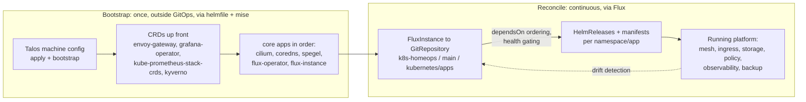
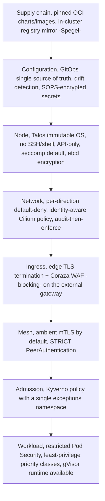
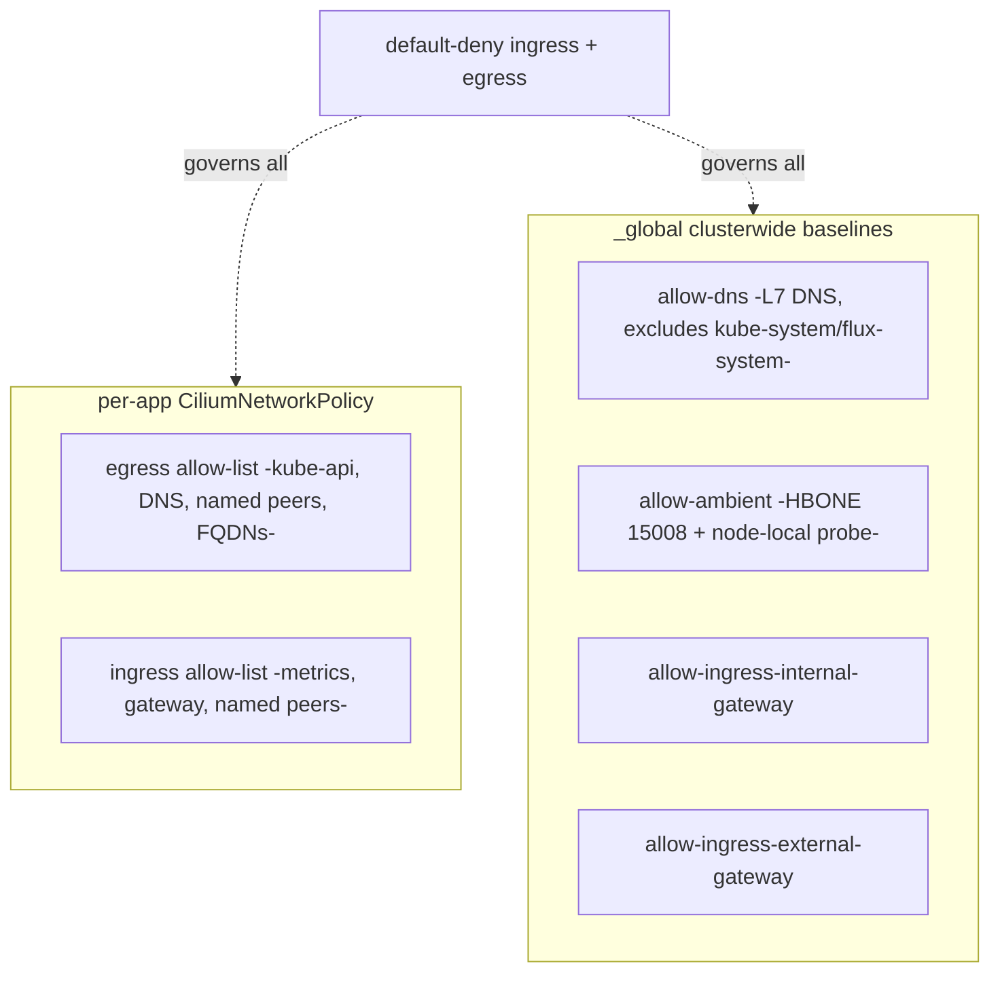
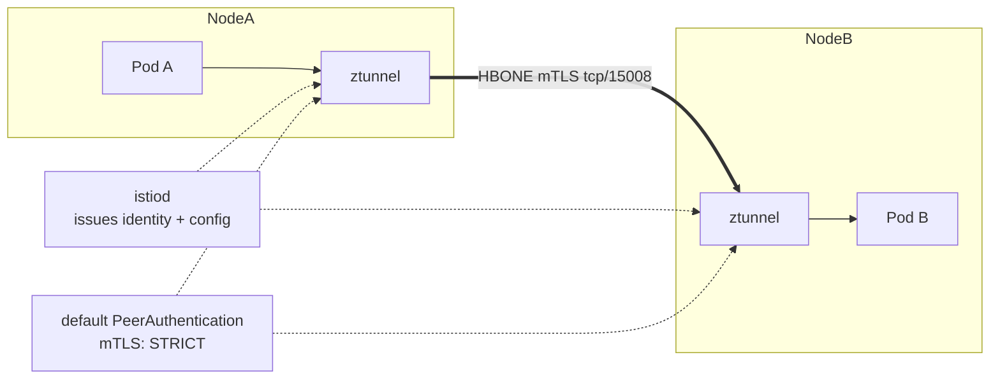
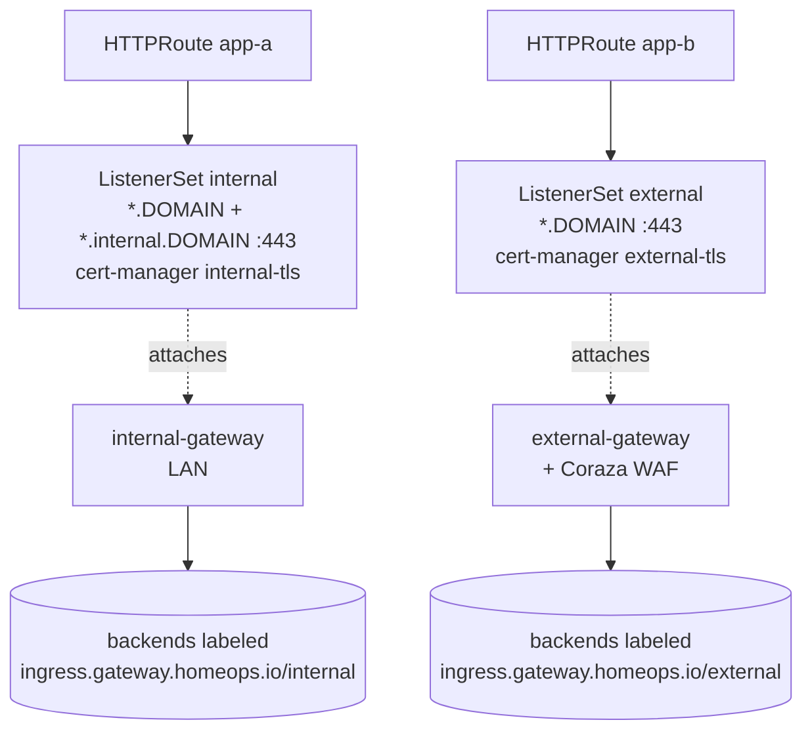
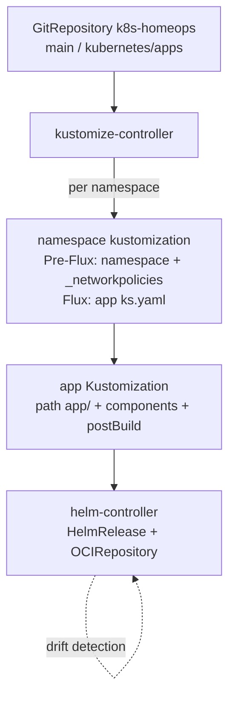

# HomeOps Cluster Reference Architecture

A living design reference for this cluster: what it is, how it functions, and the design decisions
that shape each domain, traced to the requirements, constraints, assumptions, and risks that drive
them.

Each domain section follows the same shape: **how it works** (with diagrams where they help), a
short **secure/robust by design** note, and a **design decisions** table. The fact registers in
[section 1.5](#15-fact-registers) define the Requirements (R), Constraints (C), Assumptions (A), and
Risks (X); every design decision cites the facts it answers, and each domain section opens with the
facts it is shaped by.

---

## 1. Overview

### 1.1 What this is

A single **Talos Linux** Kubernetes cluster running on **three Intel NUC 11 Pro** nodes on one flat
home network, managed end-to-end by **GitOps**. One git repository is the source of truth; **Flux**
reconciles it continuously. All three nodes are control-plane members and are also schedulable for
workloads; there is no separate worker tier.

The cluster is **secure-by-default and declarative top to bottom**: the node OS is immutable and
API-driven, the network is default-deny with identity-aware policy, east-west traffic is mTLS, and
north-south ingress terminates TLS with a WAF at the edge. There is no imperative state: if it is
not in git, it is not in the cluster.

| Property               | Value                                                                                         |
| ---------------------- | --------------------------------------------------------------------------------------------- |
| Nodes                  | 3 × Intel NUC 11 Pro (`jsdyb-nuc-00{1,2,3}`), all control-plane + schedulable                 |
| OS / Kubernetes        | Talos `v1.14.6` / Kubernetes `v1.37.2`                                                        |
| Cluster name / API VIP | `jsdyb-k8s-001`, Layer-2 shared VIP, KubePrism on the loopback (`:7445`)                      |
| CNI / mesh / ingress   | Cilium (native routing, kube-proxy replacement) / Istio ambient / Envoy Gateway (Gateway API) |
| Networks               | separate private subnets for nodes, pods, and services                                        |
| GitOps                 | Flux (flux-operator + FluxInstance), GitRepository `k8s-homeops` (`main`, `kubernetes/apps`)  |
| Storage                | Rook-Ceph (block / filesystem / S3 object store) on NVMe                                      |

### 1.2 How it functions: bootstrap, then reconcile

The cluster works in two stages. A one-time **bootstrap** lays down the pre-GitOps layer (there is
no CNI, DNS, or Flux on a fresh Talos cluster); then **Flux reconciles** everything else forever.
Both stages read the _same_ HelmRelease/OCIRepository manifests, so they cannot disagree.

Bootstrap reads chart versions/values/patches straight out of `kubernetes/apps/**` so the first
Flux reconcile is a no-op, not a fight. CRDs are installed up front, which is what lets the Flux
dependency graph stay lean.

### 1.3 Secure by design

Security is layered so no single control is load-bearing. Defense in depth, scaled to a homelab:

The properties that hold on a default install: deny-by-default networking ([section 3](#3-network));
mTLS on all meshed traffic with plaintext rejected ([section 4](#4-mesh)); TLS-terminated,
WAF-filtered external ingress ([section 5](#5-north-south-ingress)); secrets never committed in
plaintext (SOPS + external-secrets, [section 8](#8-security--policy)); an immutable, shell-less node
OS ([section 2](#2-platform-substrate)); and continuous drift correction back to git
([section 9](#9-gitops--repository)).

### 1.4 Design principles

- **Declarative everything.** Node OS, network, workloads, and policy are all git-managed desired
  state; nothing is configured imperatively.
- **One source of truth, reused.** The same manifests drive bootstrap and steady-state; the same
  Cilium policies are authored once per app.
- **Secure by default, relaxed deliberately.** Default-deny network, STRICT mTLS, blocking WAF, and
  restricted Pod Security are the shipped defaults.
- **Right-sized.** Three nodes, one cluster, one operator; decisions favor operational simplicity
  over scale-out machinery that a homelab does not need.

### 1.5 Fact registers

Every design decision below cites these. Requirements are what the cluster must do; constraints are
fixed limits it must design around; assumptions are what it takes as given; risks are what could go
wrong and how it is mitigated.

#### Requirements

| ID   | Requirement                                                                                           |
| ---- | ----------------------------------------------------------------------------------------------------- |
| R001 | One Talos cluster, managed entirely by GitOps from a single git repository as the source of truth.    |
| R002 | Every workload is reconciled by Flux (HelmRelease + manifests); nothing is applied imperatively.      |
| R003 | Run on three Intel NUC nodes, all control-plane and schedulable (no separate worker tier).            |
| R004 | The node OS is reproducible and immutable, configured declaratively.                                  |
| R005 | Zero-trust networking: per-direction default-deny with identity-aware policy.                         |
| R006 | East-west service traffic is encrypted and mutually authenticated (mTLS).                             |
| R007 | North-south ingress is standards-based (Gateway API), TLS-terminated, split internal vs external.     |
| R008 | Internet-exposed ingress is filtered by a web application firewall.                                   |
| R009 | Persistent storage for stateful workloads: block, shared filesystem, and S3 object.                   |
| R010 | Backup and restore for PVCs and databases.                                                            |
| R011 | Observability: metrics, logs, traces, dashboards, and alerting.                                       |
| R012 | Secrets are never committed in plaintext; they are encrypted at rest and resolved/rotated at runtime. |
| R013 | Admission-time policy enforcement (Kyverno), rolled out audit-first.                                  |
| R014 | Automated TLS certificate issuance and rotation for ingress hostnames.                                |
| R015 | The integrated GPU is available for media transcoding.                                                |
| R016 | LoadBalancer service IPs are reachable from the home network.                                         |
| R017 | A fresh cluster can be bootstrapped reproducibly from bare Talos to a running Flux.                   |
| R018 | An in-cluster image cache reduces dependence on external registries.                                  |

#### Constraints

| ID   | Constraint                                                                                                                          |
| ---- | ----------------------------------------------------------------------------------------------------------------------------------- |
| C001 | A fresh Talos cluster has no CNI, no DNS, and no Flux CRDs: a reconcile chicken-and-egg that bootstrap must resolve outside GitOps. |
| C002 | Talos is API-only: no SSH, no shell, no package manager; node changes are machine-config only.                                      |
| C003 | Three nodes only: etcd quorum tolerates a single node loss, and every node also carries workloads (shared blast radius).            |
| C004 | Cilium runs in native routing mode; the link-local range is not routable across nodes.                                              |
| C005 | Applying a custom resource before its CRD is registered fails the Kustomization.                                                    |
| C006 | Flux `dependsOn` orders install/upgrade only; it does not gate forever, and a missing CRD surfaces as a reconcile failure.          |
| C007 | Rook-Ceph OSDs need raw block devices; the NVMe must be left unwiped by Talos.                                                      |
| C008 | The home network is a single flat L2 behind a UniFi router (a BGP peer); there is no cloud load balancer.                           |
| C009 | Kyverno honors PolicyExceptions from exactly one configured namespace, not per-workload namespaces.                                 |
| C010 | The hardware is fixed: 3 × NUC (i7, 64 GB, 1 TB SSD + 2 TB NVMe), one NAS, one UPS, one switch, one router.                         |
| C011 | Istio ambient health-probes source from a node-local address that must be routable to the target pod.                               |

#### Assumptions

| ID   | Assumption                                                                                         |
| ---- | -------------------------------------------------------------------------------------------------- |
| A001 | The UniFi router provides DHCP reservations, a BGP peer, and upstream DNS/NTP for the nodes.       |
| A002 | A NUT-reachable UPS signals power events so nodes drain and shut down cleanly on battery.          |
| A003 | The Synology NAS provides NFS for bulk/media data mounted into the cluster.                        |
| A004 | Cloudflare hosts the public DNS zone and serves as the ACME DNS-01 solver.                         |
| A005 | GitHub hosts the repository that Flux syncs.                                                       |
| A006 | An age key (backed by GCP KMS) is available to decrypt SOPS secrets at bootstrap and at reconcile. |
| A007 | Upstream OCI chart/image registries are reachable and are cached in-cluster by Spegel.             |
| A008 | The operator holds a Talos admin context and a cluster-admin kubeconfig to bootstrap and manage.   |

#### Risks

| ID   | Risk                                                                                        | Primary mitigation                                                                                                 |
| ---- | ------------------------------------------------------------------------------------------- | ------------------------------------------------------------------------------------------------------------------ |
| X001 | A node loss removes an etcd member and ~1/3 of capacity at once.                            | 3-node quorum tolerates one loss; pod topology spread; accept degraded capacity until repair.                      |
| X002 | Default-deny network policy blocks a legitimate flow.                                       | Audit-then-enforce: Cilium policy-audit mode + Hubble to discover every real flow before enforcing.                |
| X003 | A bad WAF rule blocks legitimate traffic.                                                   | OWASP CRS paranoia level 1 + credential exclusions; WAF on the external gateway only; can drop to detection-only.  |
| X004 | An Istio chart bump breaks the istio-cni node-IP patch, breaking cross-node ambient health. | Re-verify the `HOST_PROBE_SNAT_IP` patch on every Istio upgrade.                                                   |
| X005 | A CR-shipping app whose CRD is not bootstrapped fails to apply (bootstrap/graph coupling).  | Keep the bootstrap CRD set in sync with the apps; CRDs install before Flux reconciles.                             |
| X006 | CNI churn breaks cluster-wide networking.                                                   | Treat Cilium changes as highest blast radius; bootstrap installs/updates it first, deliberately.                   |
| X007 | Loss of a node's single OSD disk, or of a log/metrics PVC, loses data within retention.     | Ceph replication size 3 (host failure domain); PVC snapshots + scheduled backups off-node.                         |
| X008 | Secret material leaks into git.                                                             | SOPS encryption enforced by `.sops.yaml` creation rules; external-secrets for runtime material; nothing plaintext. |
| X009 | The Volsync-to-Kopiur backup migration leaves a coverage gap or double-coverage.            | Migrate per app, verify a restore, then retire the Volsync path for that app.                                      |
| X010 | The in-cluster MinIO is a single backup target shared by both backup tools.                 | Ceph-backed durability for MinIO; candidate for an off-site copy.                                                  |
| X011 | Drift detection restarts live pods unexpectedly on a churny chart.                          | Drift enabled deliberately; add targeted `driftDetection.ignore` paths for self-mutating resources.                |
| X012 | ACME DNS-01 issuance depends on Cloudflare API availability.                                | Certificates are cached and long-lived; renewal retries well ahead of expiry.                                      |

---

## 2. Platform substrate

**Facts:** R003, R004, R015 · C002, C003, C007, C010 · X001

**How it works.** Each node runs **Talos Linux**, an immutable, API-only Kubernetes OS with no
shell, no SSH, and no package manager. The entire machine configuration is rendered from `.j2`
(minijinja) templates in `talos/`, with secrets decrypted from a SOPS-encrypted `talosctl` secrets
bundle, and applied via `talosctl`. All three nodes are control-plane members **and** schedulable.

Talos ships **no CNI, no kube-proxy, and no in-OS CoreDNS**; those are delegated to Cilium and the
in-cluster CoreDNS release ([section 3](#3-network)). The Image Factory schematic adds only the
extensions this hardware needs: `i915` + `intel-ucode` (iGPU transcode), `gvisor` (a sandboxed
`RuntimeClass`), `thunderbolt`, and `nut-client` (UPS shutdown). A Layer-2 VIP fronts
the API server. The install disk is the SATA SSD; the **NVMe is left raw** for Ceph to claim as an
OSD ([section 6](#6-storage--data-protection)).

### Hardware inventory

**Compute (the cluster):**

| Node            | Model            | CPU     | RAM   | OS disk       | Ceph disk |
| --------------- | ---------------- | ------- | ----- | ------------- | --------- |
| `jsdyb-nuc-001` | Intel NUC 11 Pro | Core i7 | 64 GB | 1 TB SATA SSD | 2 TB NVMe |
| `jsdyb-nuc-002` | Intel NUC 11 Pro | Core i7 | 64 GB | 1 TB SATA SSD | 2 TB NVMe |
| `jsdyb-nuc-003` | Intel NUC 11 Pro | Core i7 | 64 GB | 1 TB SATA SSD | 2 TB NVMe |

Each node keeps the OS on the 1 TB SATA SSD and leaves the 2 TB NVMe raw for Rook-Ceph to claim as
an OSD ([section 6](#6-storage--data-protection)). The i7 iGPU (`i915`) is used for media
transcoding.

**Supporting infrastructure:**

| Device                            | Role                                                                                                    |
| --------------------------------- | ------------------------------------------------------------------------------------------------------- |
| Synology RS422+ (~64 TiB)         | NAS; bulk/media storage mounted into the cluster over NFS                                               |
| UniFi Dream Machine Pro (UDM Pro) | Router / gateway and BGP peer (ASN `64510`) for LoadBalancer IP advertisement ([section 3](#3-network)) |
| UniFi 24-port PoE switch          | L2 switching and PoE for the fabric                                                                     |
| SLZB-06M                          | External Ethernet Zigbee coordinator for Home Assistant / zigbee2mqtt                                   |
| UPS (NUT-monitored)               | Power protection; nodes drain and power off via the Talos `nut-client` extension on battery             |

**Secure by design.** No SSH, no shell, no package manager means a minimal attack surface and no
drift vector. The root filesystem is immutable; the API surface is mTLS gRPC; etcd is encrypted at
rest (secretbox); seccomp-default is on. A node rebuild is re-applying config, not re-running a
runbook.

| DD    | Decision                              | Rationale                                                                  | Facts            |
| ----- | ------------------------------------- | -------------------------------------------------------------------------- | ---------------- |
| DD001 | Talos as the node OS                  | Immutable, declarative, minimal-surface host that matches the GitOps model | R004, C002       |
| DD002 | All nodes control-plane + schedulable | Three-node homelab; a dedicated worker tier is not worth the node count    | R003, C003, X001 |
| DD003 | No host CNI/kube-proxy/CoreDNS        | Cilium owns the datapath + kube-proxy replacement; CoreDNS runs in-cluster | C001             |
| DD004 | NVMe left raw for Ceph                | Rook needs an unwiped block device per node                                | C007, R009       |

---

## 3. Network

**Facts:** R005, R016 · C004, C008 · X002, X006

**How it works.** **Cilium** is the sole CNI, in **native routing** mode (no overlay:
`routingMode: native`, `autoDirectNodeRoutes`, `ipv4NativeRoutingCIDR` set to the pod CIDR) with
**kube-proxy replacement** (Talos ships no kube-proxy). LoadBalancer IPs come from Cilium
**LB-IPAM** and are advertised to the home router over **BGP** (local ASN
`64511` peering the UniFi gateway ASN `64510`); service load-balancing uses
Maglev + DSR. **Hubble** provides flow visibility.

Network policy is authored as **CiliumNetworkPolicy** per app (`_networkpolicies/` in each app dir)
plus **CiliumClusterwideNetworkPolicy** baselines in `_global`. The posture is **per-direction
default-deny** with an additive allow-list model; the clusterwide baselines re-open the
universally-required flows:

Policy was rolled out **audit-first**: Cilium `policyAuditMode` + `policyEnforcementMode: always`,
then Hubble flow observation to discover every real flow before enforcing. Policies follow a
`<app/component>-<direction>-<destination>` naming convention; `same-namespace` blanket allows were
removed in favor of explicit, identity-scoped rules.

**Secure by design.** A workload can reach nothing it is not explicitly allowed to reach, and
nothing can reach it, unless a policy says so. Policy follows workload identity (Cilium identities),
not fragile CIDR bookkeeping. Backends join a gateway by label and are reachable only from that
gateway's Envoy pods ([section 5](#5-north-south-ingress)).

| DD    | Decision                                        | Rationale                                                                 | Facts      |
| ----- | ----------------------------------------------- | ------------------------------------------------------------------------- | ---------- |
| DD005 | Cilium native routing + kube-proxy replacement  | One fast, identity-aware datapath; no overlay, no kube-proxy              | R005, C004 |
| DD006 | BGP + LB-IPAM for LoadBalancer IPs              | Advertise service VIPs to the home router without an external LB          | R016, C008 |
| DD007 | Per-direction default-deny + audit-then-enforce | Safe-by-default microsegmentation, proven in Hubble before enforcing      | R005, X002 |
| DD008 | Clusterwide baselines in `_global`              | DNS/ambient/ingress flows survive default-deny without per-app repetition | R005       |

---

## 4. Mesh

**Facts:** R006 · C004, C011 · X004

**How it works.** East-west traffic runs through **Istio in ambient mode** (`v1.31.3`): `istiod`,
`istio-cni`, and `ztunnel` in `istio-system`. Namespaces opt in with the
`istio.io/dataplane-mode: ambient` label; their pod traffic is redirected to the per-node **ztunnel**,
which carries it over mutual-TLS **HBONE** tunnels (TCP `15008`) between nodes: mTLS with a
cryptographic workload identity and **no sidecars**.

A `default` **STRICT** `PeerAuthentication` in `istio-system` rejects plaintext mesh-wide. Cilium's
own encryption (WireGuard/IPsec) is **off**: confidentiality and workload identity are Istio's job;
Cilium stays a pure L3/L4 datapath + policy engine. Cilium is configured to coexist with the Istio
CNI (`cni.exclusive: false`, `socketLB.hostNamespaceOnly: true`).

**The node-IP patch.** Ambient health-probes meshed pods from a node-local source that upstream
defaults to a link-local address, which is **not routable across nodes under Cilium native
routing**. A post-render patch on the `istio-cni` DaemonSet sets `HOST_PROBE_SNAT_IP = status.hostIP`
so probe traffic sources from the routable node IP and survives cross-node delivery.

**Secure by design.** mTLS is on by default and transparent: meshed workloads get authenticated,
encrypted service traffic with no app changes, and STRICT means plaintext is rejected, not
tolerated. Reachability is still governed by Cilium policy ([section 3](#3-network)); the mesh adds
identity + encryption on top.

| DD    | Decision                             | Rationale                                                                      | Facts            |
| ----- | ------------------------------------ | ------------------------------------------------------------------------------ | ---------------- |
| DD009 | Istio ambient over Cilium mesh       | Sidecar-free workload-identity mTLS + STRICT auth; Cilium encryption stays off | R006             |
| DD010 | `HOST_PROBE_SNAT_IP` = node IP patch | Link-local probe source is not routable under native routing                   | C004, C011, X004 |

---

## 5. North-south ingress

**Facts:** R007, R008, R014, R016 · C008 · X003

**How it works.** External traffic enters via the **Gateway API** with **Envoy Gateway** (`v1.10.0`,
`GatewayClass: envoy`). Exposure is split into two Gateways in the `gateways` namespace, each with a
BGP-advertised LB-IPAM VIP: **`internal-gateway`** (LAN-only) and
**`external-gateway`** (internet-exposed). HTTPS listeners attach via **ListenerSets**
(`allowedListeners: All`), so new hostnames scale out without editing the parent Gateway.

**TLS** is provisioned by cert-manager (`letsencrypt-prod` ClusterIssuer, **ACME DNS-01 via
Cloudflare**) for wildcard certs on each ListenerSet. **Backends opt in by label**
(`ingress.gateway.homeops.io/{internal,external}: "true"`), and clusterwide Cilium policies
(`allow-ingress-{internal,external}-gateway`) ensure only that gateway's Envoy pods may reach them,
so routing and reachability agree by construction.

**The WAF.** The **external** gateway binds **Coraza** (OWASP Core Rule Set) as an Envoy dynamic
module in **active blocking mode** (`SecRuleEngine On`, paranoia level 1), with credential fields
excluded from inspection and a companion Lua filter blocking abusive AI/crawler user-agents. The
internal gateway runs WAF-free (trusted LAN).

**Secure by design.** North-south traffic terminates TLS at the edge and, on the internet-facing
path, is scored and dropped by the WAF before reaching any backend. A route to an un-labeled backend
is dropped by default-deny.

| DD    | Decision                                       | Rationale                                                                 | Facts      |
| ----- | ---------------------------------------------- | ------------------------------------------------------------------------- | ---------- |
| DD011 | Gateway API + Envoy Gateway                    | Vendor-neutral, role-oriented ingress; data plane decoupled from the mesh | R007       |
| DD012 | ListenerSets for hostnames                     | Scale out domains without editing a monolithic Gateway                    | R007       |
| DD013 | cert-manager + ACME DNS-01                     | Automated wildcard TLS per listener without an HTTP-01 challenge path     | R014       |
| DD014 | Coraza WAF (blocking) on external gateway only | Edge filtering where risk is; low latency on trusted LAN                  | R008, X003 |
| DD015 | Label opt-in + clusterwide ingress policy      | Routing and network reachability stay consistent by construction          | R005, R007 |

---

## 6. Storage & data protection

**Facts:** R009, R010 · C007 · X007, X009, X010

**How it works.** **Rook-Ceph** (`v1.21.2`) runs a Ceph cluster on the nodes' NVMe disks (3 mons,
OSDs on the raw NVMe, `aes256k` encryption) and provides three storage classes:

- **`ceph-block`** (RBD, default): general `ReadWriteOnce` PVCs (Prometheus, Grafana, Victoria
  Logs, app config).
- **`ceph-filesystem`** (CephFS): shared `ReadWriteMany`.
- **`ceph-bucket`** (RGW, S3): in-cluster object storage.

**Data protection** is layered by workload type:

- **PVC backup** is moving from **Volsync** (restic → in-cluster MinIO, per-app `ReplicationSource`)
  to **Kopiur** (a cluster backup operator, Kopia → MinIO, one central `ClusterRepository`). The
  migration is **in flight**: Kopiur is deployed; apps still run on Volsync until each is cut over
  and restore-verified.
- **PostgreSQL** is backed by **CloudNativePG** with a reusable `cnpg` Component (Barman `ObjectStore`
  - `ScheduledBackup` to MinIO), included per database app via `postBuild.substitute`.

**Secure by design.** Ceph data is replicated (size 3, host failure domain) and encrypted;
snapshots back every protected PVC; database backups run on a schedule to object storage. Backup
targets are reached under default-deny via explicit egress labels (`egress.homeops.io/minio`).

| DD    | Decision                              | Rationale                                                      | Facts      |
| ----- | ------------------------------------- | -------------------------------------------------------------- | ---------- |
| DD016 | Rook-Ceph for block/filesystem/object | One storage system for RWO, RWX, and S3 on local NVMe          | R009, C007 |
| DD017 | Volsync → Kopiur for PVC backup       | Central operator-managed repository over per-app restic sprawl | R010, X009 |
| DD018 | cnpg Component for Postgres backup    | Author DB backup once, reuse per app via substitution          | R010       |

---

## 7. Observability

**Facts:** R011 · X007

**How it works.** **Grafana Alloy** is the single collector, deployed as three purpose-built
instances: `alloy-metrics` (clustered; scrapes ServiceMonitors/PodMonitors + kubelet/cAdvisor and
remote-writes to the **kube-prometheus-stack** Prometheus, a _storage backend_ here with scraping
disabled), `alloy-logs` (per-node DaemonSet; parses and ships pod logs to **Victoria Logs** over its
Loki-compatible endpoint), and `alloy-traces` (OTLP receiver; exports to **Tempo**). **Grafana**
(grafana-operator managed; datasources and dashboards are CRs) is the single query surface over all
three at `grafana.internal.${DOMAIN}`. Prometheus, Grafana, Victoria Logs, and Alertmanager persist
to `ceph-block`; Alertmanager routes to Pushover.

The collector, the backends, and the log-processing pipeline (parsing, `_msg`/stream-field handling,
and the per-pod `logs.observability.home.arpa/format` routing model) are detailed in
**[observability-architecture.md](observability-architecture.md)** (decisions DD029–DD031).

| DD    | Decision                                    | Rationale                                                             | Facts |
| ----- | ------------------------------------------- | --------------------------------------------------------------------- | ----- |
| DD019 | Alloy as the single collector (3 instances) | One agent for metrics/logs/traces; Prometheus is storage, not scraper | R011  |
| DD020 | Victoria Logs over Loki                     | Lighter single-binary log store; Loki-compatible ingestion            | R011  |
| DD021 | grafana-operator-managed Grafana            | Dashboards/datasources as GitOps CRs, not chart values                | R011  |

---

## 8. Security & policy

**Facts:** R012, R013 · C009 · X008, X011

**How it works.** Several layers beyond network and mesh:

- **Admission policy (Kyverno).** Policies live in `kyverno`; `PolicyException`s are confined to a
  single `kyverno-exceptions` namespace (apps ship their exceptions there via a dedicated
  Kustomization), keeping the exception surface centralized and auditable.
- **Secrets.** Two complementary mechanisms. **SOPS** (age + GCP KMS) encrypts secret files in git
  (`*.sops.yaml`); Flux decrypts them at reconcile time. **external-secrets** materializes and
  templates secrets at runtime via `ClusterSecretStore`s (the in-cluster `kubernetes` provider today,
  e.g. cross-namespace backup credentials) and **generators** (e.g. a password generator for
  rotating admin credentials). No secret material is committed in plaintext.
- **Pod Security & priority.** Namespaces default to the restricted Pod Security standard; a small
  set of `PriorityClass`es (`platform-critical/high/low`, `application-default`) orders eviction. A
  **gVisor** `RuntimeClass` is available for sandboxing untrusted workloads.
- **Drift detection.** Every HelmRelease runs Flux `driftDetection.mode: enabled`, so live objects
  are continuously corrected back to the rendered spec.

**Secure by design.** Secrets never sit in git in the clear; admission policy is centrally
exception-managed; workloads run restricted by default; and drift is actively corrected rather than
merely detected.

| DD    | Decision                                   | Rationale                                                           | Facts      |
| ----- | ------------------------------------------ | ------------------------------------------------------------------- | ---------- |
| DD022 | Kyverno with a single exceptions namespace | Centralized, auditable exception surface                            | R013, C009 |
| DD023 | SOPS (git) + external-secrets (runtime)    | Encrypted-at-rest config secrets + runtime materialization/rotation | R012, X008 |
| DD024 | Drift detection on all HelmReleases        | Live state is continuously corrected to git                         | R002, X011 |

---

## 9. GitOps & repository

**Facts:** R001, R002, R017, R018 · C001, C005, C006 · X005

**How it works.** **Flux** (flux-operator + a `FluxInstance`) reconciles the `k8s-homeops`
GitRepository (`main`, path `kubernetes/apps`). The FluxInstance patches every child Kustomization
with shared defaults: SOPS decryption, `cluster-secrets` substitution (`${DOMAIN}`, cluster name,
timezone), HelmRelease remediation/CRD policy, and projected (not auto-mounted) ServiceAccount
tokens.

The repository layout is namespace-first:
`kubernetes/apps/<namespace>/<app>/{ks.yaml, app/, _networkpolicies/, …}`, with reusable Kustomize
**Components** (`volsync`, `cnpg`) for cross-cutting patterns and a `_global` tree for clusterwide
objects. One subtlety: `_`-prefixed directories (such as `_networkpolicies/`) sit inside an app for
locality but are owned by the **parent** namespace kustomization's Pre-Flux block, not the app's
`ks.yaml`, so policy is applied ahead of and independently from the workload it governs. Each app is
one Flux `Kustomization`; the dependency graph orders real runtime needs
(storage, gateways, mesh) and **not** CRD availability. CRDs are installed at bootstrap, so
CRD-ordering edges were pruned from the graph.

**Robust by design.** One source of truth, reconciled continuously, with drift correction. Bootstrap
and steady-state share the same manifests, so there is no divergence between how the cluster is first
stood up and how it runs.

| DD    | Decision                                     | Rationale                                               | Facts            |
| ----- | -------------------------------------------- | ------------------------------------------------------- | ---------------- |
| DD025 | Flux (operator + FluxInstance) GitOps        | Continuous reconciliation of one git source of truth    | R001, R002       |
| DD026 | Namespace-first layout + reusable Components | Legible inventory; DRY cross-cutting patterns           | R002             |
| DD027 | Bootstrap reads the same manifests           | No bootstrap-vs-runtime drift                           | R017, C001       |
| DD028 | Prune CRD-ordering dependencies              | CRDs are bootstrapped; the graph encodes real deps only | C005, C006, X005 |
